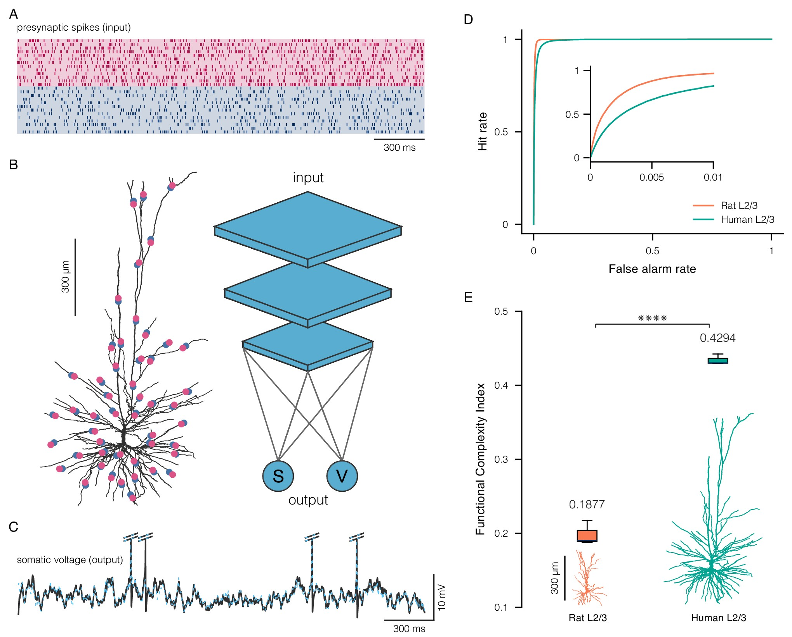

# FCI: Functional Complexity Index

This repository contains the code accompanying:

**["Dendritic morphology and synaptic nonlinearities enhance functional complexity in human cortical neurons"](https://www.pnas.org/doi/10.1073/pnas.2533168123)**

Ido Aizenbud, Daniela Yoeli, David Beniaguev, Christiaan P. J. de Kock, Michael London, Idan Segev

*Proceedings of the National Academy of Sciences* 123(28), e2533168123 (2026).

An earlier version appeared as the preprint
["What makes human cortical pyramidal neurons functionally complex"](https://www.biorxiv.org/content/10.1101/2024.12.17.628883v1).

## Abstract
Humans exhibit unique cognitive abilities within the animal kingdom, but the neural mechanisms driving these advanced capabilities remain poorly understood. Human cortical neurons differ from those of other species, such as rodents, in both their morphological and physiological characteristics. Could the distinct properties of human cortical neurons help explain the superior cognitive capabilities of humans? Understanding this relationship requires a measure to quantify how neuronal properties contribute to the functional complexity of single neurons; yet, such a standardized measure is currently missing. Here, we propose the Functional Complexity Index (FCI), a general, deep-learning-based framework for assessing the input–output complexity of neurons. By comparing the FCI of cortical pyramidal neurons across layers in rats and humans, we identified key morpho-electrical factors that underlie neuronal functional complexity. Human cortical pyramidal neurons are significantly more functionally complex than their rat counterparts, primarily due to differences in dendritic membrane area and branching patterns, as well as in the density and nonlinearity of NMDA-mediated synaptic receptors. These findings reveal the structural and biophysical basis for the enhanced functional properties of human cortical neurons, providing a key step toward understanding the underpinnings of our enhanced cognitive capabilities.



---

## Neuron models

`simulating_neurons/neuron_models/` contains all 24 detailed compartmental models compared in
the paper (12 human, 12 rat). Each model folder holds:

- `morphologies/` - the reconstructed morphology
- `mods/` - the NEURON mechanisms (AMPA/NMDA, GABA-A/B, Na, Kv)
- `get_standard_model.py` - builds the cell and distributes its synapses
- `properties.json` - the measured cable properties used to scale the somatic and axonal conductances
- `io_matrix/` - the input firing rates that make this particular neuron fire at ~1 Hz, as
  calibrated for the paper. Dataset generation reads them from here, see [step 0](#step-0-new-models-only-create-the-io-matrix).

### Human

| Model folder (under `simulating_neurons/neuron_models/`) | Layer | Morphology |
| --- | --- | --- |
| `human/eyal/Human_L23_PC_0603_11_937_Eyal_passive_dends_simple_soma` | L2/3 | `2013_03_06_cell11_1125_H41_06.asc` |
| `human/eyal/Human_L23_PC_1303_03_448_Eyal_passive_dends_simple_soma` | L2/3 | `2013_03_13_cell03_1204_H42_02.asc` |
| `human/bbp/Human_L3_PC_0_BBP_passive_dends_simple_soma` | L2/3 | `1148_H42_01.asc` |
| `human/allen/Human_L4_PC_539661667_Allen_passive_dends_simple_soma` | L4 | `H16.06.011.01.01.05.05_680109366_m.swc` |
| `human/allen/Human_L4_PC_569818704_Allen_passive_dends_simple_soma` | L4 | `H17.03.002.11.04.01_599474706_m.swc` |
| `human/bbp/Human_L4_PC_BBP_Mandge_diams_fixed_passive_dends_simple_soma` | L4 | `1496_Thijs_22juni_slice1_cell3_diams_fixed.asc` |
| `human/allen/Human_L5_PC_790872626_Allen_passive_dends_simple_soma` | L5 | `790872626_raw.swc` |
| `human/bbp/Human_L5_PC_BBP_Mandge_passive_dends_simple_soma` | L5 | `1833_Thijs_human_13april_slice2_cell1.swc` |
| `human/bbp/Human_L5_PC_0_BBP_passive_dends_simple_soma` | L5 | `2057_H21_29_197_11_01_03_metcontour.asc` |
| `human/allen/Human_L6_PC_528614014_Allen_passive_dends_simple_soma` | L6 | `H16.06.009.01.01.04.02_595952514_m.swc` |
| `human/allen/Human_L6_PC_548494556_Allen_passive_dends_simple_soma` | L6 | `H16.03.011.11.16.03_570679763_m.swc` |
| `human/allen/Human_L6_PC_558211203_Allen_passive_dends_simple_soma` | L6 | `H16.06.012.11.06.06_680112303_m.swc` |

### Rat

| Model folder (under `simulating_neurons/neuron_models/`) | Layer | Morphology |
| --- | --- | --- |
| `rat/bbp/Rat_L2_TPC_BBP_Mandge_diams_fixed_passive_dends_simple_soma` | L2/3 | `mtC191200B_idA_diams_fixed.asc` |
| `rat/bbp/Rat_L23_PC_cADpyr229_1_BBP_passive_dends_simple_soma` | L2/3 | `dend-C170897A-P3_axon-C260897C-P4_-_Clone_4.asc` |
| `rat/bbp/Rat_L23_PC_cADpyr229_5_BBP_passive_dends_simple_soma` | L2/3 | `dend-C260897C-P3_axon-C220797A-P3_-_Clone_0.asc` |
| `rat/bbp/Rat_L4_PC_cADpyr230_1_BBP_passive_dends_simple_soma` | L4 | `dend-C300797C-P4_axon-C200897C-P4_-_Scale_x1.000_y1.025_z1.000_-_Clone_11.asc` |
| `rat/bbp/Rat_L4_PC_cADpyr230_2_BBP_passive_dends_simple_soma` | L4 | `dend-C310897B-P3_axon-C220498B-P3_cor_-_Clone_1.asc` |
| `rat/bbp/Rat_L4_TPC_BBP_Mandge_passive_dends_simple_soma` | L4 | `C310897A-P4.asc` |
| `rat/bbp/Rat_L5_TPC_BBP_Mandge_passive_dends_simple_soma` | L5 | `C060114A5.asc` |
| `rat/bbp/Rat_L5_TTPC1_cADpyr232_1_BBP_diams_fixed_passive_dends_simple_soma` | L5 | `dend-C060114A2_axon-C060114A5_diams_fixed.asc` |
| `rat/hay/Rat_L5b_PC_2_Hay_passive_dends_simple_soma` | L5 | `cell1.asc` |
| `rat/bbp/Rat_L6_IPC_BBP_Mandge_diams_fixed_passive_dends_simple_soma` | L6 | `mtC110301B_idB_diams_fixed.asc` |
| `rat/bbp/Rat_L6_TPC_BBP_Mandge_passive_dends_simple_soma` | L6 | `Fluo41_left.asc` |
| `rat/bbp/Rat_L6_UPC_BBP_Mandge_passive_dends_simple_soma` | L6 | `Fluo12_right.asc` |

### Which model is which neuron in the paper

The paper identifies these neurons by a morphology identifier (`2057`, `L2 TPC`, `548494556`)
and by their order in Fig. 2, never by folder name, and for 7 of the 24 that identifier appears
only inside the morphology filename - three folders even carry a different number (`937` for
1125, `448` for 1204, `0` for 2057). [`models.csv`](models.csv) is the join:

| column | |
| --- | --- |
| `order_in_fig2`, `species`, `layer`, `morphology_identifier`, `citation` | SI Appendix, Table S1 |
| `model_folder`, `morphology_file`, `synapse_type` | this repository |
| `fci` | the value printed above that neuron in Fig. 2A |
| `fci_rat_synapses` | its FCI when given rat-type synapses, i.e. Fig. S5A |

[`morphological_features.csv`](morphological_features.csv) holds the 65 morphological features
of each morphology - the numbers behind Fig. 3, which are published only as correlations. They
are computed with NeuroM and TMD exactly as the paper's analysis does it, and reproduce its
reported R² values (total dendritic area 0.743 against the published 0.74).

Note which FCI those correlations use: Fig. 3 regresses the features on **`fci_rat_synapses`**,
where every morphology carries the same rat-type synapses, so that morphology is the only thing
varying. Using the `fci` column instead gives 0.35 for total dendritic area rather than 0.74.

The sub-folder names give the origin of the morphology and biophysics: `eyal` (Eyal et al.),
`allen` (Allen Cell Types Database), `hay` (Hay et al.) and `bbp` (Blue Brain Project human and
rat models). `diams_fixed` marks a morphology whose reconstructed dendritic diameters were
corrected, and `passive_dends_simple_soma` marks the standard configuration used throughout the
paper: passive dendrites with a spiking (Na/Kv) soma and axon.

---

## Usage

The FCI pipeline consists of three main steps:
1. **Create a simulation dataset** for a neuron model
2. **Train a TCN** (Temporal Convolutional Network) on the dataset
3. **Calculate the FCI** from the trained model

Before step 1 there is a calibration step: the model's **io matrix**, the input firing rates that
make that particular neuron fire at ~1 Hz. Every model here ships the io matrix that was used in
the paper and step 1 picks it up on its own, so [step 0](#step-0-new-models-only-create-the-io-matrix)
is only needed for a new model.

### Prerequisites

- Python 3.8+
- NEURON simulator
- PyTorch
- SLURM (optional - for cluster job submission; use `--use_local` flag for local execution)

Install dependencies:
```bash
pip install numpy scipy pandas matplotlib torch scikit-learn h5py peakutils numba confidenceinterval wandb
```

### Quick test

`quick_test.py` runs all four steps below end to end on one model, with tiny settings, to check
that the pipeline works in your environment. It takes 5-10 minutes on 4 cpu cores, no GPU
needed:

```bash
cd simulating_neurons/neuron_models/rat/hay/Rat_L5b_PC_2_Hay_passive_dends_simple_soma && nrnivmodl mods && cd -
python quick_test.py
```

It creates a small io matrix, generates a small dataset (using the io matrix that the model
ships), trains a small TCN for a few hundred steps and calculates the FCI from it, into
`quick_test_output/`. Use `--stages dataset train fci` to skip the io matrix step, and
`--neuron_model_folder` to run it on a different model.

The FCI it prints is meaningless - it comes from a small network trained for a few hundred steps
on a handful of simulations. Use it to check that things run, not to get a number.

---

### Step 0 (new models only): Create the io Matrix

How hard a neuron is to drive is a property of that neuron: a model with a large dendritic
membrane area needs very different input rates than a small one to fire at the same output rate.
The **io matrix** measures this, by simulating a grid of (excitatory, inhibitory) input firing
rates - in spikes per synapse per second - and recording the output firing rate of each. The
`legitimate_options` are the (exc, inh) rate pairs whose output firing rate lands inside
`--legitimate_output_fr_range` (0.9-1.1 Hz in the paper), and they are what the simulations of a
dataset draw their input rates from.

This matters for comparing models: without it, neurons are driven at arbitrary and different
output firing rates, and their FCI values cannot be compared with each other or with the paper.

Every model in `simulating_neurons/neuron_models/` already ships its calibrated io matrix in
`<model folder>/io_matrix/`:

- `legitimate_options.json` - the 20 calibrated (exc, inh) input firing rate ranges. Dataset
  generation reads this file automatically, so **for the models in this repository you can skip
  this step**.
- `io_matrix.csv` - every input rate bin that was probed and the output firing rate it produced,
  i.e. the measured io matrix itself.

For a **new** model, create one with:

```bash
python simulating_neurons/create_io_matrix.py \
    --neuron_model_folder <path to the new model> \
    --io_matrix_folder /path/to/output/io_matrix \
    --save_to_neuron_model_folder \
    --use_local
```

`--save_to_neuron_model_folder` writes the result into `<model folder>/io_matrix/`, where dataset
generation looks for it. This is the expensive step - it runs `--count_simulations_for_option`
(20) simulations for every probed rate bin, a few hundred bins in total - so on a cluster leave
out `--use_local`.

**Key parameters:**
- `--legitimate_output_fr_range`: the output firing rate window that defines a usable input rate pair (default: `0.9 1.1` Hz)
- `--legitimate_options_count`: how many rate pairs to collect (default: 20)
- `--count_simulations_for_option`: simulations to average over per probed bin (default: 20)
- `--exc_fr_per_synapse_bin_size` / `--inh_fr_per_synapse_bin_size`: width of a rate bin (default: 0.05 Hz per synapse)

---

### Step 1: Create a Dataset for a Neuron Model

#### 1.1 Compile the NEURON model

First, navigate to the neuron model folder and compile the MOD files:

```bash
cd simulating_neurons/neuron_models/rat/hay/Rat_L5b_PC_2_Hay_passive_dends_simple_soma
nrnivmodl mods
```

This will create an architecture-specific folder (e.g., `x86_64/`) containing the compiled mechanisms.

#### 1.2 Generate the simulation dataset

Use the `submit_simulate_neuron_and_create_dataset.py` script to generate training, validation, and test datasets. This script submits SLURM jobs to run neuron simulations in parallel.

```bash
python simulating_neurons/submit_simulate_neuron_and_create_dataset.py \
    --neuron_model_folder simulating_neurons/neuron_models/rat/hay/Rat_L5b_PC_2_Hay_passive_dends_simple_soma \
    --simulation_dataset_folder /path/to/output/dataset \
    --simulation_dataset_name my_neuron_dataset \
    --count_simulations_for_train 100 \
    --count_simulations_for_valid 20 \
    --count_simulations_for_test 20
```

**Running without SLURM (local execution):**

If you don't have access to a SLURM cluster, you can run simulations locally using the `--use_local` flag:

```bash
python simulating_neurons/submit_simulate_neuron_and_create_dataset.py \
    --neuron_model_folder simulating_neurons/neuron_models/rat/hay/Rat_L5b_PC_2_Hay_passive_dends_simple_soma \
    --simulation_dataset_folder /path/to/output/dataset \
    --simulation_dataset_name my_neuron_dataset \
    --count_simulations_for_train 20 \
    --count_simulations_for_valid 5 \
    --count_simulations_for_test 5 \
    --use_local \
    --max_local_workers 4
```

**Key parameters:**
- `--neuron_model_folder`: Path to the compiled neuron model
- `--simulation_dataset_folder`: Output folder for the dataset
- `--simulation_dataset_name`: Name for the dataset
- `--count_simulations_for_train`: Number of training simulations (default: 10000, as in the paper)
- `--count_simulations_for_valid`: Number of validation simulations (default: 10)
- `--count_simulations_for_test`: Number of test simulations (default: 2500, as in the paper)
- `--use_local`: Run jobs locally instead of using SLURM (default: False)
- `--max_local_workers`: Maximum parallel workers for local execution (default: CPU count - 1)

The script will create `train/`, `valid/`, and `test/` subdirectories containing the simulation data.

**Input firing rates.** The input rates of each simulation are drawn from the model's io matrix
(step 0), which is read from `<neuron_model_folder>/io_matrix/legitimate_options.json`
automatically - so the command above reproduces the input statistics used in the paper. Passing
`--exc_fr_per_synapse_options` / `--inh_fr_per_synapse_options` explicitly overrides them, as
flat `low_0 high_0 low_1 high_1 ...` lists in spikes per synapse per second. A model with no io
matrix falls back on placeholder rates and warns; that fallback drives the neuron at an arbitrary
output firing rate, and its FCI cannot be compared to anything.

Each simulation writes the sparse excitatory and inhibitory input spike trains, the somatic
voltage trace and a summary. How much that is depends on the model - one driven at higher input
rates has more spikes to store - and ranges from ~0.7 MB per simulation (rat L4) to ~4.9 MB
(human L5 2057), i.e. 10-60 GB for a full 10000/10/2500 dataset.

---

### Step 2: Train a TCN on the Dataset

Once the dataset is generated, train a Temporal Convolutional Network (TCN) to predict the neuron's output spikes from its synaptic inputs:

```bash
python training_nets/train_neuron_tcn.py \
    --simulation_dataset_folder /path/to/output/dataset/my_neuron_dataset \
    --neuron_tcn_folder /path/to/output/tcn \
    --neuron_tcn_name my_neuron_tcn
```

**Key parameters:**
- `--simulation_dataset_folder`: Path to the dataset created in Step 1
- `--neuron_tcn_folder`: Output folder for the trained model
- `--neuron_tcn_name`: Name for the trained TCN
- `--depth` / `--width`: TCN architecture (defaults: 3 and 128, as in the paper)
- `--maximum_train_steps`: how long to train (default: 500000, as in the paper)
- `--run_on_gpu`: pass `False` to train on the cpu

The training will log metrics including AUC (Area Under the ROC Curve), which is used to calculate the FCI.

The FCI of a neuron in the paper is the one of the *best* of several networks trained on it (a
depth 3, width 128 TCN, trained for up to 500000 steps, repeated a few times with different
seeds), scored with the normalized AUC - see step 3.

---

### Step 3: Calculate the Functional Complexity Index (FCI)

After training, calculate the FCI using the `calculate_fci.py` script:

```bash
python calculate_fci.py --neuron_tcn_folder /path/to/output/tcn/my_neuron_tcn
```

**Options:**
```bash
# Calculate FCI from a trained TCN folder
python calculate_fci.py --neuron_tcn_folder /path/to/neuron_tcn

# Calculate FCI from a specific results file
python calculate_fci.py --results_pkl /path/to/model_X_Y_test_results.pkl

# Calculate FCI from a specific AUC value
python calculate_fci.py --auc 0.95

# Use normalized AUC (from normalized firing rate test set)
python calculate_fci.py --neuron_tcn_folder /path/to/neuron_tcn --use_normalized
```

The paper reports the FCI of the normalized AUC (`--use_normalized`), which is measured on a
subset of the test set whose average output firing rate is exactly 1 Hz. Comparing neurons with
the plain AUC mixes in how often each of them happened to fire.

#### FCI Formula

The FCI is calculated from the AUC as:

$$\text{FCI} = \frac{\log_{10}(1000 \times (1 - \text{AUC}))}{\log_{10}(1000 \times (1 - 0.9))}$$

Where:
- AUC = 0.9 → FCI = 1.0 (maximum complexity)
- AUC = 0.999 → FCI ≈ 0.0 (near-perfect prediction, low complexity)

---

## Citation

```bibtex
@article{aizenbud2026fci,
    title   = {Dendritic morphology and synaptic nonlinearities enhance functional complexity in human cortical neurons},
    author  = {Aizenbud, Ido and Yoeli, Daniela and Beniaguev, David and de Kock, Christiaan P. J. and London, Michael and Segev, Idan},
    journal = {Proceedings of the National Academy of Sciences},
    volume  = {123},
    number  = {28},
    pages   = {e2533168123},
    year    = {2026},
    doi     = {10.1073/pnas.2533168123},
}
```

